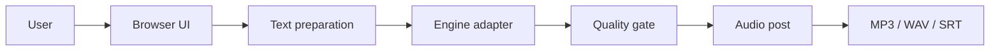
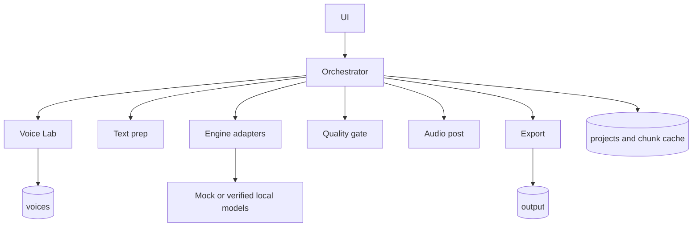
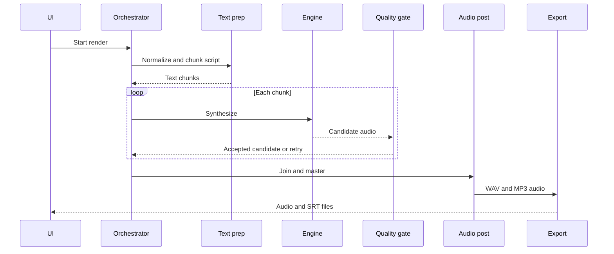
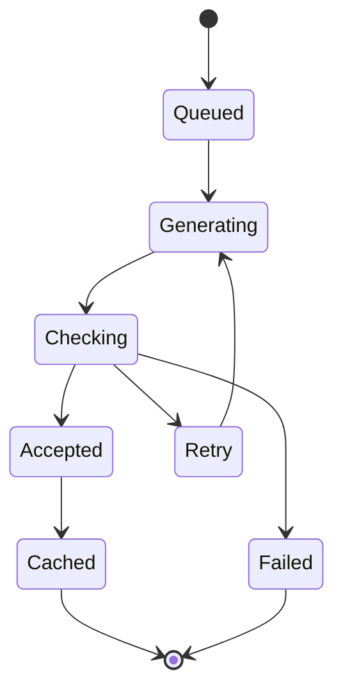
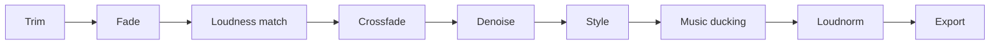
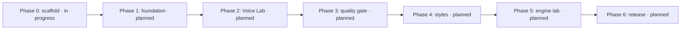

# Kothok (কথক) — Bangla Voice Studio

**A free, local Windows studio for narrating Bangla scripts in your own voice.**


> UI screenshot: pending a verified app run. Phase 0 has a minimal synthetic
> preview UI; no screenshot is published until it can be run and captured.

## Why Kothok

Bangla creators need narration tools that do not send personal recordings to a
remote service. Kothok is designed around:

- Free local processing, with no paid API or telemetry.
- Bangla-first scripts and a browser workflow.
- Voice profiles made only from the owner's own recordings.
- Cinematic pacing and sound design as the pipeline grows.
- A quality gate and explicit listening checks before release claims.

## Feature overview

| Feature | What it does | Status |
| --- | --- | --- |
| Browser preview | Runs a Gradio UI and emits a synthetic tone | Phase 0 scaffold |
| Voice Lab | Clean and score a reference clip | Planned |
| Bangla voice cloning | Synthesize with a verified local model | Planned; model unverified |
| Styles and sound | Apply genre processing and optional licensed audio | Planned |
| MP3, WAV, SRT export | Deliver mastered narration and subtitles | Planned |

## Quick start (Windows)

### Prerequisites

- Windows 10/11 and Python 3.10 or newer.
- FFmpeg is required by planned audio processing; Phase 0 synthetic preview
  does not call it.

### Install and run

1. Double-click `setup.bat` and wait for setup to finish.
2. Double-click `run.bat` to open the browser UI.
3. Enter a short text sample (Bangla text is accepted).
4. Click **Create synthetic preview**.
5. Listen to the tone and close the app window when finished.

The Phase 0 tone is only a pipeline placeholder. It does not speak or clone a
voice. See [Next steps](docs/NEXT.md) for current readiness and blockers.

## How it works



The browser collects text and settings. Text preparation will normalize and
split the script into resumable chunks. An engine adapter generates each
chunk, and the quality gate checks it before joining. Audio processing applies
style, optional licensed music, and loudness targets. The exported files stay
on the local machine. Phase 0 implements only the UI and a synthetic mock.

## System design



| Module | Responsibility | Key files |
| --- | --- | --- |
| UI | Browser workflow | `app.py` |
| Text prep | Unicode normalization, markup, chunking | Planned `core/text_prep.py` |
| Voice Lab | Reference cleanup and profile handling | Planned `core/voice_lab.py` |
| Engines | Common synthesis interface | `core/engines/` |
| Quality gate | Candidate scoring and retry | Planned `core/quality.py` |
| Audio post | Stitching, style, mix, mastering | Planned `core/audio_post.py` |

The data path is UI → orchestrator → text prep → engine → quality gate → audio
post → export. Every engine implements `load()`, `speak(text, reference,
params)`, and `sample_rate`. The chunk cache will key generated audio by text,
voice, engine, and settings so edited sentences can be rerendered alone.
Projects will store script, chunk status, and exports under `projects/<name>/`.
Long jobs will run in a background worker with progress, time estimates, and a
stop control. Heavy engines will use separate virtual environments to avoid
dependency conflicts. See [Architecture](docs/ARCHITECTURE.md) and
[Decisions](docs/DECISIONS.md).

### Render sequence



### Chunk state



### Audio post chain



## Visualisations

Planned generated figures will use synthetic or public-domain signals only.
They will be added with alt text, captions, and sample-data labels as the
relevant audio pipeline is implemented.

| Figure | What it demonstrates | Status |
| --- | --- | --- |
| Denoising waveform and spectrogram | Before/after signal behavior | Planned |
| Loudness timeline | Movement toward -16 LUFS | Planned |
| Chunk seam | Crossfade and room-tone behavior | Planned |
| Engine bake-off | Measured fixture results, clearly labelled | Planned |
| Render time | Mock and available engine timing | Planned |

## Models and licences

| Engine | Licence | Size | Non-commercial? | Status |
| --- | --- | --- | --- | --- |
| MockEngine | Project MIT | Tiny | No | Scaffold only; synthetic tone |
| BosonLab Chatterbox Bangla | Unverified | Unverified | Unverified | Do not download/use until verified |
| IndicF5 / XTTS / A2TTS | Must verify primary model cards | Varies | Varies | Planned research |

## Project layout

```text
app.py                 Gradio entry point
core/                  Pipeline services and engines
docs/                  Plan, decisions, progress, and handoff
tests/                 Offline checks
scripts/               Developer checks and figure generation
requirements/          Pinned dependency groups
library/                Local sound assets and licence records
voices/ models/         Ignored personal profiles and model files
projects/ output/       Ignored projects and generated audio
```

## Configuration

The single `config.yaml` will hold the default engine, local model directory,
audio sample rate, loudness target, chunk limits, and style settings. It is not
present yet; configuration lands with Phase 1.

## Testing and quality

Run `scripts\check.bat` for Ruff and pytest. GitHub Actions uses
`windows-latest` and the model-free test path only; it must never download model
weights. The synthetic engine can validate application plumbing, not Bangla
pronunciation, cloning quality, or human-perceived naturalness. Those require a
real verified adapter and the checks in [Listening tests](docs/LISTENING_TESTS.md).

## Roadmap



| Phase | Status |
| --- | --- |
| 0. Repository and scaffold | In progress |
| 1. Foundation and first verified engine | Planned |
| 2. Voice Lab | Planned |
| 3. Quality gate and merge | Planned |
| 4. Styles and sound | Planned |
| 5. Engines and tuning | Planned |
| 6. Release | Planned |

## Troubleshooting and FAQ

- **Python isn't found:** install Python 3.10+ and enable its PATH option.
- **Setup cannot install packages:** verify internet access for first-time
  dependency installation, then rerun `setup.bat`.
- **Where are my recordings stored?** Personal profiles and generated files are
  local and excluded from Git.
- **Does the preview clone my voice?** No. Phase 0 emits a synthetic tone.

## Ethics

Kothok is for cloning and narrating only with the owner's own voice. Never use a
recording without the speaker's explicit permission.

## Contributing

Read [AGENTS.md](AGENTS.md), then check [Next steps](docs/NEXT.md). Keep model
downloads out of CI, add tests for behavior, and document unverified claims.

## Licence

MIT; see [LICENSE](LICENSE). Individual model and sound assets may have
different terms and must be checked separately.

## Credits

Phase 0 uses Python's standard library, Gradio, pytest, Ruff, and GitHub Actions.
Future model and sound-library credits will be listed after their licences and
attribution requirements are verified.
