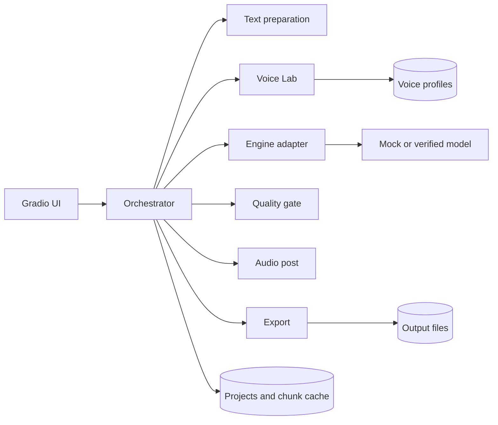

# Architecture

Phase 0 provides a browser entry point, an offline mock engine, and the future
module boundaries. The mock emits synthetic tones and is never presented as
voice cloning or Bangla speech.

## Data flow

## Modules

| Module | Responsibility | Key files |
| --- | --- | --- |
| UI | Browser interaction | `app.py` |
| Engine | Uniform synthesis boundary | `core/engines/` |
| Tests | Model-free verification | `tests/` |

## Engine interface

Adapters expose `load()`, `speak(text, reference, params)` and `sample_rate`.
The mock uses standard-library WAV output, which keeps scaffold checks independent
of downloaded models and audio packages.

## Storage and caching

Personal voice data belongs under ignored `voices/`; models under `models/`;
rendered files under `output/`; resumable projects under `projects/`. These
directories are not committed. Chunk caching and project resume arrive with the
quality-gate phase.

## Engine environments and model licences

The UI environment is pinned separately from future heavy engine environments.
No real model is installed in Phase 0. Model IDs, licences, sizes, and any
non-commercial conditions are recorded here only after checking their primary
model cards.
